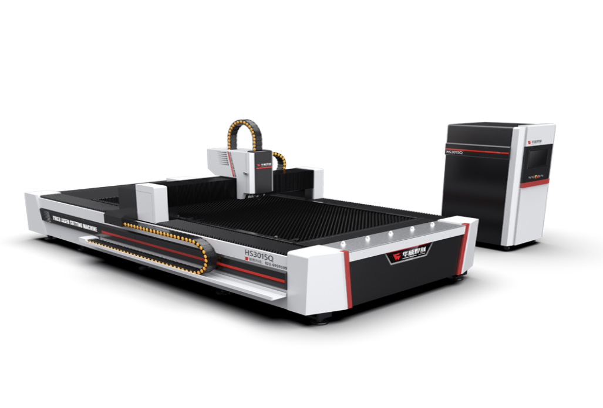
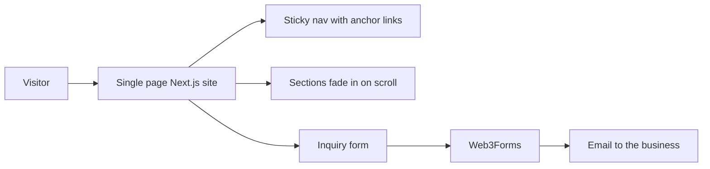

# Siddesh Engineering Works Website

The business website for Siddesh Engineering Works, a precision sheet metal manufacturer in India. It presents the company's services, machines, products and clients, and lets customers send an inquiry straight from the page. Built as a single page Next.js site with smooth scroll animations and a mobile menu.

<p align="center"></p>

## What the site covers

| Section | Content |
|---|---|
| Home | Company introduction and call to action |
| About | Who the company is and what it makes |
| Services | Laser cutting, CNC punching, fabrication and enclosures |
| Capabilities | CNC fiber laser cutting, CNC press brake and CNC turret punching machines |
| Products | Metal enclosures, counters and shelving, with photos |
| Clients | Nine client companies across several industries |
| Contact | Contact person and an inquiry form |

## How it works



* **One page, many sections.** The navigation bar links to each section, and a toggle menu takes over on phones.
* **Animation.** Framer Motion fades and slides each section in as it scrolls into view.
* **Inquiries without a backend.** The form posts name, phone, email and requirement to Web3Forms, which emails the business. No server or database is needed.
* **Search ready.** Page metadata sets a descriptive title, description and keywords such as sheet metal manufacturing, laser cutting and metal fabrication.

## Tech stack

| Area | Tools |
|---|---|
| Framework | Next.js App Router, React, TypeScript |
| Styling | Tailwind CSS |
| Animation | Framer Motion |
| Forms | Web3Forms |

## Project structure

```
app/
  page.tsx       All sections, navigation and the inquiry form
  layout.tsx     Fonts and page metadata
  globals.css    Tailwind setup
public/images/   Machine and product photos
```

## Running it

```bash
npm install
npm run dev
```

Open http://localhost:3000. To build for production:

```bash
npm run build
npm start
```

## Author

Siddhesh Patil
